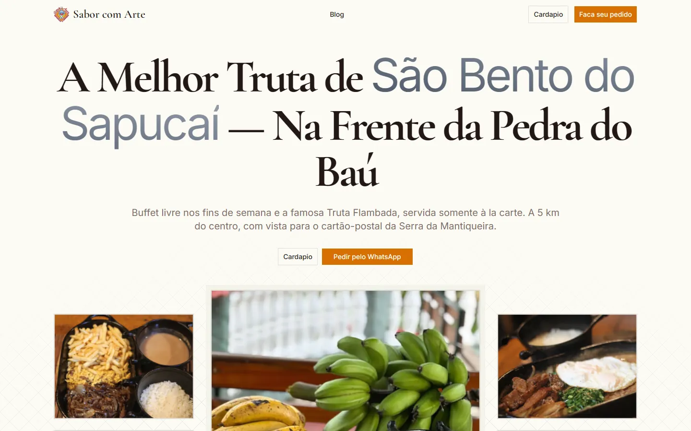

# Sabor com Arte

Restaurant in São Bento do Sapucaí, SP, known for flambéed trout, weekend buffet and a view of Pedra do Baú.



**Live:** <https://sabor-com-arte-5rao.vercel.app>

## Features

- Browse the full menu, embedded as a PDF on the Cardápio page
- Order through WhatsApp with one-tap links from the navbar and the hero
- Read the blog with local dining guides and restaurant tips (MDX posts)
- Find the restaurant on an embedded Google Maps map, plus a FAQ section
- Discover the sister businesses: Pousada Riacho Doce (chalets) and Artesanato Paiol das Artes (crafts)
- Search-friendly pages with JSON-LD structured data, sitemap and robots.txt

## Tech stack

- Astro 6 (static pages, React islands) with the Vercel adapter
- React 19, Tailwind CSS 4, shadcn/ui on Radix UI
- GSAP and Framer Motion for animations
- MDX for blog posts, Inter and Cormorant Garamond fonts via Astro's font API
- Hosted on Vercel

## Getting started

### Prerequisites

- Node.js 22.12.0 or newer

### Install

```sh
git clone https://github.com/joao-carmassi/sabor-com-arte.git
cd sabor-com-arte
npm install
cp .env.example .env
# Fill in the variables in .env (see Configuration), then:
npm run dev
```

Open http://localhost:4321 in your browser.

To check the production build locally:

```sh
npm run build
npm run preview
```

## Configuration

Copy `.env.example` to `.env` and set these variables. The site throws at build or render time if any of them is empty.

| Variable | Purpose |
| :--- | :--- |
| `PUBLIC_BASE_PATH` | Public site URL, used for canonical links, sitemap and structured data |
| `PUBLIC_CARDAPIO_PDF_URL` | URL of the menu PDF embedded on the Cardápio page |
| `PUBLIC_ZAP_NUMBER` | WhatsApp number used by the order links (country code and area code, digits only) |
| `PUBLIC_PHONE_NUMBER` | Phone number shown on the site |
| `PUBLIC_EMAIL` | Contact email shown on the site |

## Deployment

The site is deployed on Vercel through the `@astrojs/vercel` adapter. Add the same variables from `.env` to the Vercel project's environment settings, and set `PUBLIC_BASE_PATH` to the production URL.

## License

No license specified.

---
Made by [João Carmassi](https://github.com/joao-carmassi)
